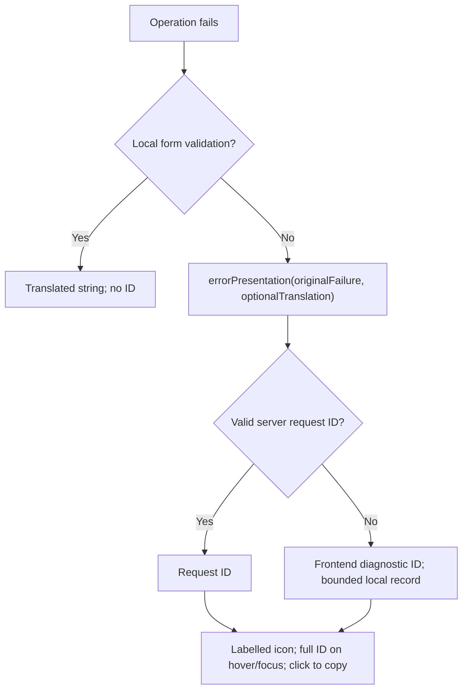

# Error diagnostics



Use `ErrorPresentation` for inline, loading, modal, store, and alert error state.
Keep the original failure when choosing a custom translation; passing only `statusCode`, `errorMessage`, or a new error discards the request identity.

```ts
const error = ref<ErrorPresentation>("");
try {
    error.value = "";
    await operation();
}
catch (failure) {
    error.value = errorPresentation(failure, t("error_loadingData"));
}
```

Render with `GlobalErrorText` or a structured `GlobalAlert`; `icon=false` suppresses only the decorative error icon.
Keep pre-submission required/length/selection messages as ordinary strings and clear the entire error state on reset, success, or a new attempt.
Expected cancellations produce no diagnostic, and successful authentication recovery exposes no intermediate error.

Use `showRuntimeFailure` for background failures that have no inline surface.
OAuth fetch responses use `authResponseFailure` / `authTokenGrant` before SDK initialization, then carry only a diagnostic reference in route-specific history state to the login view.
Login consumes and removes that state; no global last-request ID or diagnostic query parameter is used.

The local path is installed before async initialization, with a DOM fallback if mounting fails.
Frontend UUIDs remain stable for an object occurrence across Vue proxies and custom-message mapping.
At most 100 sanitized session records contain ID, classification, portal/version, and timestamp; `frontendDiagnosticRecords()` and the `Frontend diagnostic` console entry expose them without storing payloads, credentials, or exception text.
Remote APM capture uses the same ID only when the existing environment, authentication, analytics-consent, and active-agent gates allow it; offline capture does not remove the local record.

The diagnostic button supports pointer, keyboard, and touch, announces copy success, and provides a selectable full-ID input when clipboard access fails.
Labels and feedback are localized in all supported locales.

## Verification and release

This branch targets `@medrunner/api-client` 0.7.0-dev.3 and works against legacy and normalized API failures.
The version must be published and the registry lock regenerated before a frozen CI installation can consume the dependency update.
The coordination manifest records this release gate separately from source, type, production-build, and browser evidence.

Run the portal's normal test, type-check, and build scripts.
For isolated browser checks, serve `scripts/diagnostics-smoke.html` with Vite on port 5274 and run the infra repository's `scripts/error-diagnostics.e2e.mjs` against its loopback `ErrorDiagnosticsProbe`.
The fixture imports the real SDK, shared presentation, locales, and CSS without using an authenticated session or production backend.
The runner verifies full tooltip/copy equality, final retry identity, matching API log records, frontend record linkage, clipboard denial, bootstrap fallback, legacy compatibility, and ID-free local validation.

The initial coordinated rollout uses the `preview` channel with `-dev.N` versions and staging consumers.
Exact versions are calculated from current tags/commits and confirmed by semantic-release CI before downstream lockfiles are generated.
